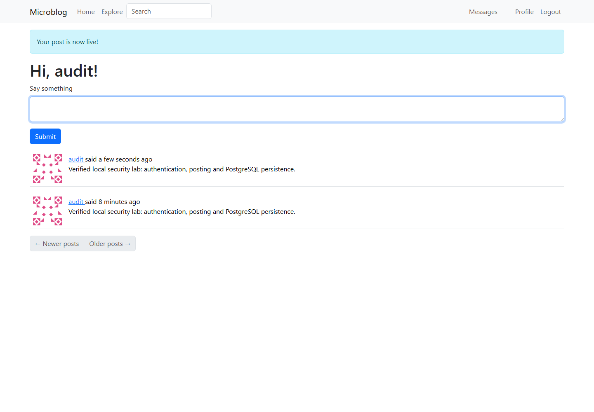
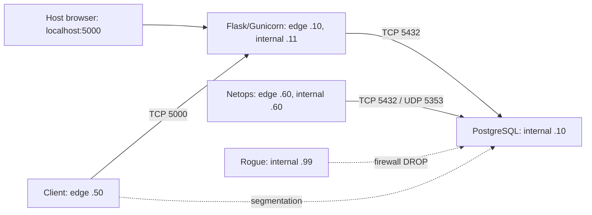

# Tesselonix — Application Security Audit & Network Troubleshooting

Reproducible local assessment of **Microblog**, with vulnerable and hardened images,
two verified source findings, an isolated PostgreSQL network lab, regression tests,
raw evidence and submission reports. AI assistance is disclosed in [TOOLS_AND_AI.md](TOOLS_AND_AI.md).

Verified results: **4 upstream tests pass on baseline; 15 tests pass on hardened**.
Live HTTP/JWT proofs, TCP/UDP captures, access checks after recreation, and a
Chromium login/posting smoke test are included under `evidence/`.
The full verifier also passed from a clean clone with new credentials and separate
volumes; see `evidence/clean_clone.txt`. Browser checks include protected bearer API reads.



**Target:** https://github.com/miguelgrinberg/microblog  
**Exact upstream commit:** `a975ef64864354867c88e0ed3a17ba7d17dca752`  
**Upstream license:** MIT; retained at `app/microblog/LICENSE`.

The app is vendored as ordinary tracked files so a single clone contains everything.
The `upstream-baseline` tag preserves the unmodified audited app; `main` and
`security-hardening` contain the final submission. This deliberately avoids nested
Git repositories that disappear from a normal parent-repository clone.

## Start here

Prerequisites: Git, Python **3.11+**, Docker Desktop with Linux/WSL2 engine running,
Docker Compose v2, internet for initial image/package downloads, about 3 GB free disk.
Commands below run in PowerShell from the repository root. No host Python packages
are needed to build, run or verify the lab.

```powershell
git clone https://github.com/devashishsaxen/tesselonix-security-network-assessment.git
cd tesselonix-security-network-assessment
python scripts/setup.py
python scripts/build.py
docker compose --env-file .env -f lab/docker-compose.net.yml up -d --wait
Start-Process http://localhost:5000
```

Register a local account, sign in, write a post and visit Explore. The core web UI,
authentication, token API and PostgreSQL persistence run locally. Optional upstream
email, translation, Elasticsearch, Redis/RQ export workers are not configured;
they are outside this assessment. Bootstrap/Moment/Gravatar assets may need internet.

Use **localhost** for this local demo. Cookies retain `Secure` for hardening; browser
localhost exceptions permit local testing. A deployment on a real hostname needs
HTTPS termination. Do not weaken cookie flags to make plain HTTP deployment work.

## Reproduce all evidence

```powershell
python scripts/verify.py
```

This switches between baseline and fixed Task A stacks, runs both test suites,
reproduces a deliberately exposed database in the Task B lab, applies hardening,
captures TCP/UDP traffic and repeats access tests after container recreation.
It asserts expected outcomes and stops with an error if a proof fails. It preserves
database volumes, creates/updates the disposable `audit` account, replaces evidence
files and leaves the hardened network lab running. A private demo login is written
to ignored `.build/demo-login.txt`; credentials are excluded from the repository.
Run `python scripts/verify.py app` or `python scripts/verify.py network` for one phase.

```powershell
docker run --rm tx-microblog:fixed pytest -q tests.py test_security.py
docker compose --env-file .env -f lab/docker-compose.net.yml ps
docker compose --env-file .env -f lab/docker-compose.net.yml down
```

`down` retains data. Use `down -v` only when you intend to erase this lab's data.
Never run both Task A and Task B at once: both use host port 5000.

## Architecture



Edge: `172.28.10.0/24`; internal: `172.28.20.0/24`. Both app and admin are
dual-homed, with IP forwarding explicitly disabled. They are **not IP routers**.
The app mediates requests at the application layer. Docker bridge gateways are
shown in the [network report](reports/02-network-assessment.md) and diagram.

Only `127.0.0.1:5000` is published in the secure topology. The insecure override
temporarily publishes `127.0.0.1:15432` to container port 5432, never all host interfaces. The DB firewall
allows app/admin TCP and admin UDP, dropping unlisted sources. The rogue node
proves a firewall denial from a directly connected source.

## Findings and submission files

| ID | Verified weakness | Change |
|---|---|---|
| A-1 | Auth endpoints permit unthrottled attempts | POST rate limits; regression tests |
| A-2 | Public fallback signing key permits reset JWT forgery | Fail closed, random env key, cookie flags |
| N-1 | Deliberately introduced DB exposure and permissive firewall | Remove publication; source allowlist |

- [Security findings](reports/01-security-findings.md)
- [Network assessment](reports/02-network-assessment.md) and [SVG topology](reports/network-diagram.svg)
- [Before/after verification](reports/03-verification.md)
- [Technical reflection](reports/04-reflection.md)
- [Walkthrough and explanation](reports/05-walkthrough.md)
- [Submission checklist](SUBMISSION.md)
- `fixes/security-hardening.diff`: exact application changes from baseline
- `evidence/app/`, `evidence/network/`: actual redacted transcripts and packet capture
- `evidence/screenshots/`: browser demonstration

The signed JWTs, passwords, DB URL, cookies and private random key are withheld.
The known upstream default is public source text, not an operational credential.
No scans target a public IP or a real organizational network.

## Build details and limitations

`scripts/build.py` exports the baseline tag to a temporary directory before building
`:baseline`, then builds `:fixed` from the current source. It does not switch branches
or risk accidentally rebuilding baseline from hardened code. Keep tags when cloning;
ZIP recipients can use the included Git bundle (see SUBMISSION.md).

The limiter uses memory with one Gunicorn worker in this lab. It resets on process
restart and is not a complete distributed brute-force defense. Production requires
shared Redis-backed limits, account-aware controls, monitoring, MFA and TLS.
Upstream dependencies are intentionally pinned to the audited revision; this is a
focused assessment, not a claim that an old tutorial app is production secure.
IP allowlists trust the container network and do not defend against a privileged
Docker administrator or source spoofing by a compromised privileged node.

If build/download fails, check Docker Desktop and network access. If port 5000 is
busy, stop the other **assessment** stack; do not stop unrelated services. If the
172.28 subnets overlap an existing Docker network, change all Compose addresses,
firewall rules and verification targets consistently before proceeding.
